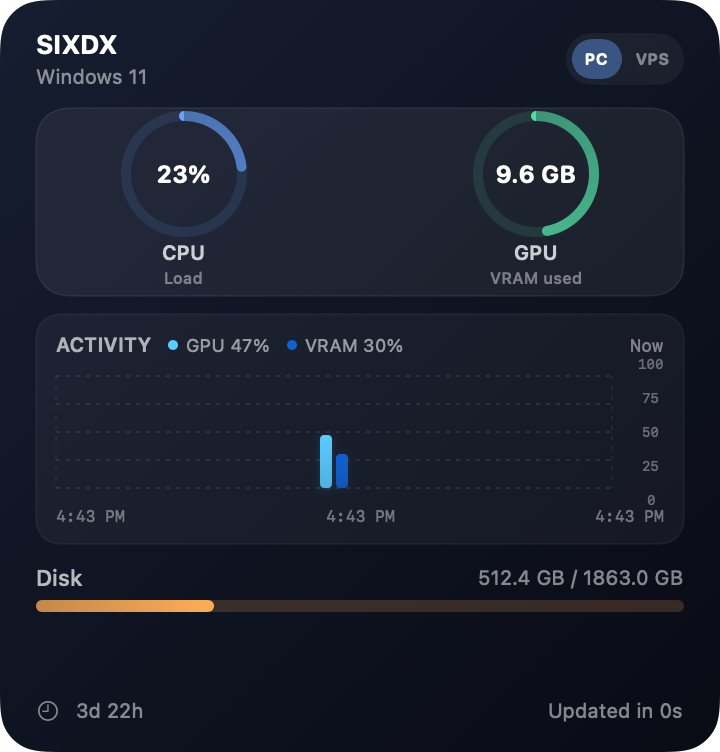
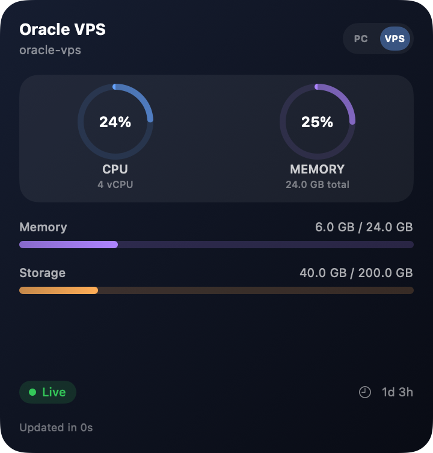

<h1 align="center">Pulse</h1>
<p align="center"><strong>Your PC and VPS. One quiet corner of your Mac.</strong></p>
<p align="center">A native macOS menu bar app and desktop widget for monitoring your Windows PC and Linux server.</p>
<p align="center"><a href="#quick-start">Quick start</a> · <a href="#windows-agent">Windows</a> · <a href="#linux--oracle-vps-agent">Linux / Oracle VPS</a> · <a href="#build-the-mac-app">Build for Mac</a></p>

<table>
  <tr><th>Windows PC</th><th>Linux / Oracle VPS</th></tr>
  <tr>
    <td></td>
    <td></td>
  </tr>
</table>
<p align="center"><sub>Rendered previews with sample readings.</sub></p>

## At a glance

- **Switch on the widget.** Compact **PC / VPS** buttons change systems without opening a window.
- **See the metrics that matter.** CPU, RAM, storage, and uptime; NVIDIA GPU usage, VRAM, and temperature on Windows.
- **Keep it quiet.** Pulse lives in the menu bar. **Advanced** opens the dashboard and connection settings.
- **Keep systems separate.** Each connection has its own credentials, cached readings, and history.
- **Know when a system is offline.** Previous readings remain available; a missing connection never substitutes the other machine's data.
- **Choose your size.** Small, medium, and large widgets, plus a classic large layout.

## Quick start

1. [Build and launch Pulse on your Mac](#build-the-mac-app) running **macOS 14 Sonoma or later**.
2. Install an agent on your [Windows PC](#windows-agent), your [Linux VPS](#linux--oracle-vps-agent), or both.
3. On your Mac, choose **Pulse menu bar → Advanced → gear**, enter the connection details, and save.
4. Right-click the desktop → **Edit Widgets** → **Pulse**. Add a widget and use **PC / VPS** to switch.

> The commands below install the **monitoring agent on the target machine**. They do not install the Mac app.

## Windows agent

**Requires:** Windows PowerShell, Python **3.10+** on PATH, and administrator approval during setup.

Paste this single line into **PowerShell on your Windows PC**:

```powershell
Invoke-WebRequest -UseBasicParsing 'https://raw.githubusercontent.com/StevenSteel7/Pulse/main/windows-agent/download.ps1' -OutFile "$env:TEMP\pulse-install.ps1"; if ($?) { powershell.exe -NoProfile -ExecutionPolicy Bypass -File "$env:TEMP\pulse-install.ps1" }
```

[View the download script](windows-agent/download.ps1) · [Direct download](https://raw.githubusercontent.com/StevenSteel7/Pulse/main/windows-agent/download.ps1) · [Windows setup guide](windows-agent/README.md)

The installer downloads the agent to `%LOCALAPPDATA%\PulseAgent`, asks for your PC's LAN IPv4 address, creates a Python environment, generates an API key, adds a firewall rule for the **Private** network profile, and starts a scheduled task. The agent starts again when you log in. An existing configuration is preserved on reinstall.

Copy the printed **host**, **port**, and **API key** into Pulse's **PC** settings. GPU metrics require an NVIDIA GPU with `nvidia-smi`; other metrics work without it.

## Linux / Oracle VPS agent

**Requires:** a systemd-based Linux distribution and sudo access. Supports Ubuntu, Debian, and Oracle Linux on **ARM64 or x86-64**. Python 3 is installed if needed.

Run this on your **Linux server**:

```bash
curl -fsSL https://raw.githubusercontent.com/StevenSteel7/Pulse/main/linux-agent/install.sh -o pulse-install.sh && sudo bash pulse-install.sh
```

[View the installer](linux-agent/install.sh) · [Direct download](https://raw.githubusercontent.com/StevenSteel7/Pulse/main/linux-agent/install.sh) · [Linux setup guide](linux-agent/README.md)

The self-contained installer detects your CPU, RAM, and root filesystem, generates an API key, and starts an unprivileged systemd service that runs at boot. It preserves your connection settings and key on reinstall. No pip packages or containers are needed.

### Connect securely from your Mac

By default, the Linux agent listens on **127.0.0.1:8801**. Keep this SSH tunnel running on your **Mac**, replacing `USER` and `VPS_IP` with your SSH login and server address:

```bash
ssh -N -o ExitOnForwardFailure=yes -o ServerAliveInterval=30 -o ServerAliveCountMax=3 -L 127.0.0.1:8802:127.0.0.1:8801 USER@VPS_IP
```

In **Advanced → gear → Oracle VPS**, enter:

| Setting | Value |
|---|---|
| Host / IP | `127.0.0.1` |
| Port | `8802` |
| HTTPS | Off — the SSH tunnel encrypts the connection |
| API key | The key printed by the Linux installer |

Click **Save**, then **VPS** on the widget. Closing the tunnel makes the VPS unavailable until you reconnect. This setup uses your existing SSH access and requires no extra public port.

Already using a private network or VPN? Bind the agent to the VPS's reachable private interface with `--bind YOUR_PRIVATE_IP --port 8801`. [See the connection options](linux-agent/README.md#optional-direct-privatevpn-connection).

## Build the Mac app

Requires full **Xcode** with a macOS 14+ SDK. The generated Xcode project is included.

```bash
git clone https://github.com/StevenSteel7/Pulse.git
cd Pulse
open Pulse.xcodeproj
```

1. In Xcode, choose the **Pulse** project and open **Signing & Capabilities** for both **Pulse** and **PulseWidgetExtension**.
2. Select the same development team for both targets. The shared App Group uses `$(DEVELOPMENT_TEAM).com.stevensteel.pulse`.
3. Select the **Pulse** scheme and run it. Look for its icon in the menu bar; the dashboard opens from **Advanced**.

If you regenerate the project, set your team in `project.yml` first, then run `xcodegen generate`. XcodeGen is only required when regenerating the project.

To package a DMG after configuring signing:

```bash
./build_dmg.sh YOUR_TEAM_ID
```

The result is `dist/Pulse.dmg`. Development signing supports local development; distribution to other Macs requires an appropriate signing and notarization workflow. This repository does not provide an automated notarized release.

To start Pulse at login, add it in **System Settings → General → Login Items**.

## How it works

```text
Windows PC ── read-only stats agent ──┐
                                     ├── Pulse on Mac ── menu bar + desktop widget
Linux VPS ── agent over SSH / VPN ────┘
```

Agents expose `GET /stats`, authenticated with an `X-API-Key` header. Pulse polls the selected system every five seconds while running and shares its cached readings with the widget through a macOS App Group.

**Widget redraw timing is controlled by macOS.** Pulse requests refreshes, but a five-second poll does not guarantee a five-second desktop widget update. The menu bar and dashboard display the app's latest readings directly.

The PC/VPS selection is shared across Pulse widgets and the app. Legacy single-PC settings migrate automatically. Linux servers use a CPU, memory, and storage layout rather than empty GPU gauges.

## Troubleshooting

| Symptom | Check |
|---|---|
| Windows agent is unreachable | Confirm its LAN address, API key, Private network profile, and `SixdxStatsAgent` scheduled task. |
| VPS shows offline | Keep the SSH tunnel running. The default app-side port is **8802**, while the server listens on **8801**. |
| Linux service won't start | Run `sudo journalctl -u pulse-agent -n 40 --no-pager`. |
| Widget has no data but the app does | Both Xcode targets must use the same team and App Group. |
| Desktop widget updates slowly | Keep Pulse running; WidgetKit controls redraw scheduling. |
| Windows GPU says unavailable | Check that `nvidia-smi` works. CPU, RAM, and disk monitoring remain available. |

## Development

```text
Pulse/             macOS menu bar, dashboard, and settings
PulseWidget/       WidgetKit layouts and timeline provider
Shared/            Models, system selection, caches, and App Intent
windows-agent/     Windows agent, installer, and GitHub bootstrap
linux-agent/       Self-contained Linux installer and service
tests/             Linux endpoint and Swift storage/decoding checks
docs/images/       Widget previews using sample data
```

Run the local checks on macOS:

```bash
./tests/run.sh
```

These cover the Linux payload's metric parsing and authentication, Swift JSON decoding, settings migration, and separate system caches. Windows setup and a real Linux systemd installation require their respective operating systems.

## Connection notes

Agents provide read-only telemetry. LAN HTTP does not encrypt the API key; use an SSH tunnel, a private VPN, or an HTTPS reverse proxy for remote access. Pulse supports HTTPS connections. The Linux installer does not change Oracle Cloud or host firewall rules.

Keep live `config.json` files and API keys out of Git. The included ignore rules cover runtime configuration and local build output. Mac connection keys are stored in the shared App Group's `systems.json`, not the Keychain.

[Detailed installation commands](GITHUB-INSTALL.md) · [Windows guide](windows-agent/README.md) · [Linux guide](linux-agent/README.md)
